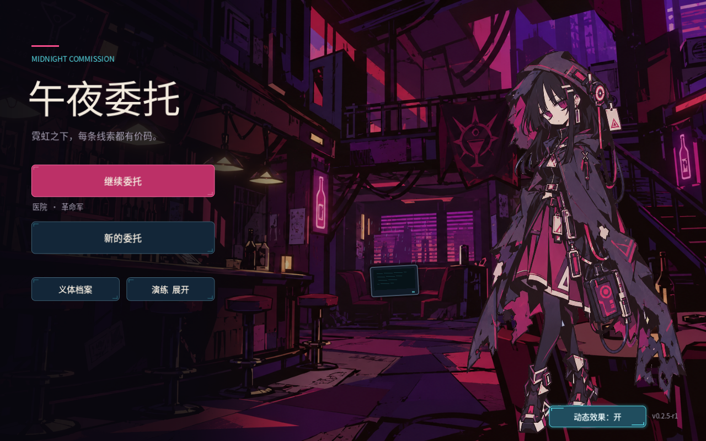

# 主菜单制作 TODO

## 中文笔画缺口修复（2026-10-13）

- [x] 撤回会造成静态笔画缺损的 MSDF，恢复抗锯齿栅格字体与自动采样。
- [x] 保留平滑霓虹故障和 3 秒周期，对比实际字形确认静态缺口消失。

## 清晰度与过渡修正（2026-10-13）

- [x] 字标独立 MSDF 渲染，常态彩边对齐，近处辉光收弱。
- [x] 笔画、颜色与辉光改为连续进入／回弹／归位，保持 3 秒周期。
- [x] 双尺寸图形检查与相位连续性检查通过，更新 50Hz 相位动画预览。

## 故障节奏微调（2026-10-12）

- [x] 最新周期改为每 3 秒一次：故障 0.60 秒、清晰间隔 2.40 秒；下方旧时序保留为历史。

## 常驻间歇霓虹故障（2026-10-12）

- [x] 改为 1 秒循环：故障 0.60 秒、清晰恢复间隔 0.40 秒。
- [x] 保留正体、放大字号与现有辉光，动态开关仍可立即恢复静态字形。

## 正体放大与强化辉光（2026-10-12）

- [x] 四字改正体，82px 放大至 92px，重排标题装饰。
- [x] 增强青红霓虹辉光，保持清楚的冰白字芯。
- [x] 删除独立明暗闪烁，仅保留每 8 秒一次霓虹故障。
- 验证与动图详见主菜单验收记录。

## 文字本体特效纠正（2026-10-12）

- [x] 霓虹明暗／泛青直接作用于四字正文。
- [x] 故障改为真实笔画切片错位，短暂出现后恢复清晰字形。
- [x] 保持低频、动态开关与静态恢复，提供 Godot 渲染帧动画预览。

## Logo 清晰度与低频动效（2026-10-12）

- [x] 减轻加粗、倾斜与色差，完整正文取代常驻切口。
- [x] 每 10.6 秒一次短暂霓虹变化和一次细条故障，正文保持清晰稳定。
- [x] 动态开关联动、静态即时复位、返回菜单保持偏好。
- 验证细节及首轮大窗口失焦记录见主菜单验收记录。

## 四字 Logo（2026-10-12）

- [x] 删除英文副标题和中文标语，只保留四字标题。
- [x] 加粗前倾字标、青红静态色差与斜切装饰。
- [x] 双尺寸实际渲染检查，各 43 项 capture 检查通过；详见主菜单验收记录。

## 全屏密集牌库（2026-10-10，0.3.21-library）

- [x] 牌库占满游戏画布，七列紧凑排版，一屏可完整显示 21 张。
- [x] 右上角“×”关闭，保留 Esc，去掉底部返回区。
- [x] 两种分辨率各 39 项专项检查通过，验证多卡容量、滚动、退出和存档隔离。

## 主菜单牌库（2026-10-10，0.3.20-library）

- [x] 增加“牌库”入口及四列浏览页面，当前展示四种测试战斗卡。
- [x] 总目录按 ID 去重，不依赖冒险牌组或获得记录；新增卡牌定义自动收录。
- [x] 只读卡面、滚动、按钮／Esc 返回主菜单，保留原冒险和存档。
- [x] 两种分辨率的专项输入和截图检查；结果见主菜单验收记录。

## 原生高清修复（2026-10-08，0.3.18-hd）

- [x] 直接使用原生全彩 PNG，保留原图与旧 GIF 资料。
- [x] 局部 shader 复现动作和灯牌，保留原循环速度与布局。
- [x] 实际渲染对比及 50 项高清动画专项通过。
- [x] 核对正式存档未变，更新维护、来源、截图与独立工程包。
- [ ] 完整 input 与持续性能套件尚未全部通过，失败和边界见主菜单验收记录。

## 审核 GIF 与右侧菜单接入（2026-10-07）

按用户新确认，使用 `assets/menu/noren-bar-idle-motion-v2-neon.gif` 作为背景，
标题与入口移到右侧；用户随后指定 1.5 倍速，实际循环为 3.2 秒。
源帧保持 60 帧与每帧 80ms。本轮另行验收，不沿用 P0 结果。

- [x] G00：核对审核 GIF、当前菜单和维护边界，保留修改前文件与存档快照。
- [x] G01：无损提取 60 帧，60/60 RGB 像素一致，核对 80ms 时长和来源哈希。
- [x] G02：接入序列播放、静态模式、失焦暂停和退出清理。
- [x] G03：完成右侧轻量菜单、标题及局部文字遮罩。
- [x] G04：用户自行完成游戏内验证并确认通过；自动两尺寸各 89 项通过。
  宽屏失焦和性能采样中断的记录保留，不声明自动性能验收通过。
- [x] G05：更新来源、维护说明与本轮验收证据。

## 首版 P0 历史记录

依据[主菜单重构规划](主菜单重构规划.md)，于 2026-10-07 开始执行。
用户已授权完成首版 P0：酒馆窗边与委托终端、五个既有入口、窗外雨、
局部霓虹、终端提示灯和静态模式。本表只按实际完成与验证结果核销。

- [x] M00：核对规划、菜单流程、素材和工程约定。
- [x] M01：保存修改前文件、实际菜单截图及正式存档哈希。
- [x] M02：检查原酒馆与诺伦静止站姿构图，保留菜单空间与角色辨识。
- [x] M03：接入主次菜单、标题与只读进度摘要。
- [x] M04：完成继续、新游戏确认、科技档案和两种演练的实际输入。
- [x] M05：使用用户原图副本，接入窗口、霓虹、终端局部遮罩，保存来源与 SHA256。
- [x] M06：接入窗外雨、局部霓虹、终端提示灯，检查循环与遮挡。
- [x] M07：完成静态开关、失焦暂停、退出清理与安全返回。
- [x] M08：完成三尺寸输入各 65 项、20 秒动画观察和性能对照。
- [x] M09：核对并如实记录存档差异、完成隔离复核、更新维护与验收说明。

首版已作为 **0.2.5-r1** 交付。追加隔离检查 66 项、地图回归 111 项均零失败；
原始图片与工程副本未变，隔离复核前后 10 项正式存档路径未变。初始快照与最终
正式检查点／备份存在两项测试开始前的更新，来源未确认，不回滚当前进度，详见
[验收记录](主菜单验收记录.md)。

证据根目录为 `artifacts/qa/menu-redesign-2026-10-07/`。首版不包含规划
中的 P1／P2；不自动提交或推送本轮变更，完成后交付工程内文件及截图。
