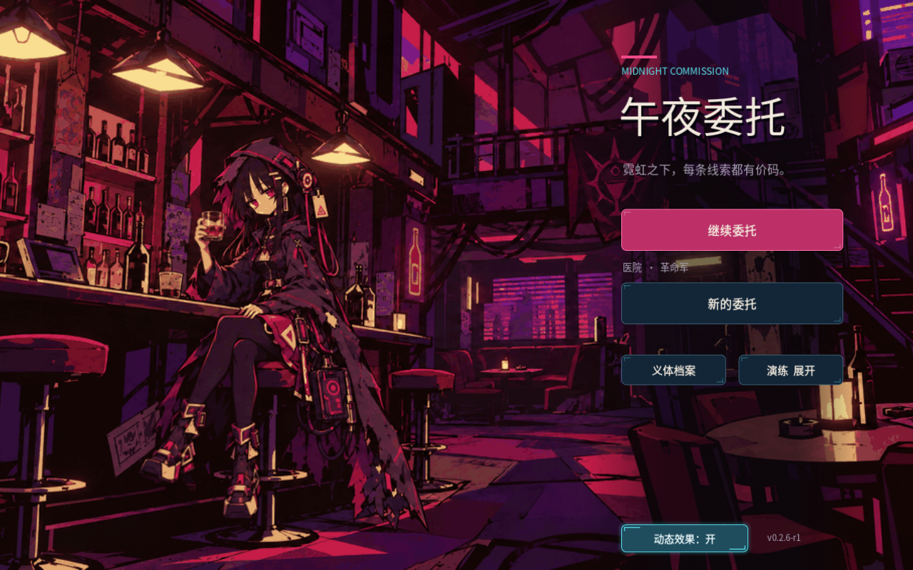

# 主菜单验收记录

## 角色动效拉扯修正（2026-10-16）

用户反馈主菜单角色扭曲。旧实现对完整插画局部反向采样，杯／手、双靴约 4.95°／4.29°／3.25° 的旋转配合仅 ±7—8 像素边界过渡，造成轮廓压缩拉伸；原有像素变化测试只证明会动，不能证明没有变形。调整为 0.60°／0.28°／0.22° 的轻微待机，边界过渡改为 ±16 像素，扩展裁切边界，并将合并位移限制在 1.5 原图像素以内。运行时角色与灯光按连续相位更新，静态第 0 帧完全无几何形变，重开动态从零相位开始。原图、白亮调色、菜单布局和灯牌关键帧保留。

Godot 4.7.2／Compatibility，实际 1600×1000 的 `native_art` **74 项、0 失败**。新增 GPU 形变场检查：复用生产 shader 的完整几何代码，只替换最终颜色输出，采样 0／15／30／45／59 帧的位移、相邻像素位移差及映射行列式。最大位移约 1.259 原图像素、最大相邻差约 0.070、最小行列式约 0.906，没有采样折叠；静态读回残差约 0.022 像素来自 8-bit 量化。另检查帧内连续相位和循环接缝；保留手脚像素变化、灯牌、开关、暂停、离开释放与偏好恢复验证。观察正反极值全图及前后局部对比，旧版靴子轮廓拉扯明显，新版保持形状。

1280×800 对比捕获另有 **46 项、0 失败**，将修改前 shader／摆幅与新版按相同周期渲染为 40 组帧，合成为 3.2 秒循环 GIF：左旧、右新。该预览是 Godot 相位渲染帧合成，不是实时录屏；不作为帧率测试。两次运行均隔离 autoload 用户目录与存档路径，关闭自动保存，日志无脚本或 shader 错误；未重跑全游戏。

证据、修改前副本、差异与生成预览脚本：`artifacts/qa/menu-motion-stable-2026-10-16/`。

[前后动效对比](../artifacts/qa/menu-motion-stable-2026-10-16/before-after.gif)

## 中文静态缺口修复（2026-10-13）

用户反馈字内缺口，经静态帧对比确认上一轮 MSDF 字体模式导致「委」等笔画局部缺损，关闭特效时仍存在；不是故障位移。上轮参数检查未覆盖字形像素完整性，目视验收漏检。现恢复字标独立抗锯齿栅格字体及自动采样，保留平滑动效、正体字号与三秒周期。

Godot 4.7.2／Compatibility 在实际 1280×800、1600×1000 窗口重新渲染，参数／连续性／复位共 **13 项通过**；目视比较同一常态相位的新旧字标，确认静态缺口消失。该字体修复结论来自渲染图对比，不把参数通过等同于像素完整性自动测试；未运行全游戏或性能回归。

证据：`artifacts/qa/menu-logo-gaps-2026-10-13/raster/`，旧图在 `menu-logo-smooth-2026-10-12/graphics-msdf/`。本轮保存修改前脚本、隔离检查脚本、结果、双尺寸截图及新的相位动图；存档路径继续隔离。

[修复后的常态字标](../artifacts/qa/menu-logo-gaps-2026-10-13/raster/preview-00.png) · [修复后的动效](../artifacts/qa/menu-logo-gaps-2026-10-13/fixed-preview.gif)

## 清晰度与连续过渡（2026-10-13）

字标独立使用 MSDF 字体，常态彩边对齐、降低近处光晕重叠；92px 正体、位置和每 3 秒一次的周期保持。故障位移、色差与辉光改为连续进入／回弹／恢复。最初尝试的 3 倍栅格采样未获得理想观感，未作为最终方案；最终仅字标切换 MSDF，共享字体与导入配置未改变。

Godot 4.7.2／Compatibility，`graphics-msdf/result.json` 共 **13 项通过**：独立字体与共享资源隔离、正体／字号、三秒周期、四周期事件计数、完整字形覆盖、60Hz 采样下位移／辉光连续性、常态彩边对齐、关闭复位，以及实际 1280×800／1600×1000 窗口核对。最大位移单步 0.517 像素、最大辉光倍率单步 0.056；属于确定性相位检查，不是 FPS 或连续播放性能测量。实际查看小尺寸常态局部、大尺寸故障全图，未见文字或容器裁切。

证据：`artifacts/qa/menu-logo-smooth-2026-10-12/`，最终截图在 `graphics-msdf/`，早期 `graphics/` 与 `graphics-linear/` 保留为试验记录。图形测试按 PID 激活隔离 QA 窗口，正式游戏进程未结束；用户目录及存档路径隔离。

[平滑动效预览](../artifacts/qa/menu-logo-smooth-2026-10-12/smooth-preview.gif) 使用故障段 50Hz 的实际 Godot 相位渲染帧合成，完整周期 3 秒；它展示动效曲线，不是连续录屏。旧预览仅有少量关键帧，不能据其播放观感推断游戏实时帧率。本轮没有运行全游戏或性能回归。

## 常驻间歇循环（2026-10-12）

按用户要求，仅调整字标故障时序为 1 秒循环：故障 0.60 秒、跨周期的完整清晰间隔 0.40 秒。正体、字号、辉光与布局沿用。故障仍直接作用于笔画，关闭动态效果即恢复清晰静态。

隔离 Godot 4.7.2 相位检查 **7 项全部通过**：对四个周期共 240 个采样点核对四次故障、约 60% 故障占比、所有相位都有完整文字、两个错位方向，以及关闭后的文字、辉光和处理开关复位。此结果为确定性相位采样，不是连续播放时长实测。

图形首轮保留截图和预览帧，但连续时钟／次数两项受失焦影响失败；前台重试又在 40 秒超时退出，不计通过。现场同时存在正式游戏进程，未结束该进程。此前双尺寸布局结果是历史验证，本次仅改时序，不复用为本轮连续播放通过结论。

证据在 `artifacts/qa/menu-logo-loop-2026-10-12/`：`phase-result.json` 为通过结果，`run.log`、`focused.log` 保留图形失败／超时，`phase_check.gd/.tscn` 为隔离检查脚本。测试 autoload 与保存路径均隔离。

[常驻故障节奏预览](../artifacts/qa/menu-logo-loop-2026-10-12/loop-preview.gif) 由 Godot 实际渲染的离散相位帧按 1 秒循环合成，用于展示节奏，不是连续录屏。

## 正体放大与强化辉光（2026-10-12）

四字取消倾斜，字号从 82px 放大至 92px；增加四层青色／洋红外扩辉光，冰白字芯保持锐利。独立明暗闪烁已删除，仅保留每 8 秒一次、持续 0.20 秒的霓虹笔画故障，故障期间光晕同步增强。标题容器扩为 `410×170`，位于 `(960,120)`，按钮位置不变。

Godot 4.7.2／Compatibility，在固定实际窗口大小后，1280×800、1600×1000 各 **23 checks、0 failures**。覆盖实际窗口尺寸、正体与字号、无独立变暗／泛青、文字光晕层、笔画故障、Space 开关即时恢复、静态时钟和返回菜单偏好。每尺寸采样 8 秒动画时钟，仅一次约 0.20 秒故障；本轮不替代完整菜单／战斗或性能验证。已查看小尺寸完整主菜单和大尺寸故障局部，字形完整且标题不碰按钮。

证据目录：`artifacts/qa/menu-logo-neon-2026-10-12/`。最终结果为 `1280-fixed/`、`1600-fixed/`，含逐项结果、截图与预览帧。早期 `1280x800-final/` 的实际窗口为 2940×1846，不能按请求参数计作 1280×800；首轮 `1600x1000/` 失焦导致时钟断言失败，随后截图等待停滞，终止该测试进程并保留日志。测试脚本增加实际窗口尺寸设置、核对、前台请求与超时退出后，在游戏代码及原动画断言不变的情况下完成最终双尺寸复测。所有测试继续隔离 autoload 用户目录和存档路径。

[霓虹故障预览](../artifacts/qa/menu-logo-neon-2026-10-12/neon-preview.gif) 由 Godot 渲染相位帧按 8 秒周期合成，背景冻结；不是连续录屏。实际周期另由逐帧测试验证。代码与隔离验证副本保持一致。

## 文字本体特效（2026-10-12，按用户纠正）

霓虹变化改为直接作用于正文亮度和颜色；故障改为真实笔画切片横移，停止使用「正文完全不变」的旧方案。常态字形保持清晰，效果分别仅持续 0.30 秒与 0.18 秒，周期 10.6 秒，动态开关仍控制字标。

Godot 4.7.2／Compatibility，隔离窗口 1280×800、1600×1000 各 **20 checks、0 failures**。验证文字本身降亮且不闪灭、故障时五段完整字形切片接替正文、笔画实际横移、通过视口 Space 关闭时恢复字形／亮度／颜色，以及返回菜单保持静态偏好。每尺寸实际观察 10.5 秒动画时钟，仅发生一次短暂故障；未重跑全游戏或背景性能测试。查看小尺寸完整故障帧及大尺寸字标局部，错位可见且四字仍可辨认。

证据目录 `artifacts/qa/menu-logo-letter-fx-2026-10-12/` 包含脚本备份、隔离测试脚本、日志、每尺寸 result.json、完整截图及预览帧。autoload 用户目录和保存路径均隔离。

[字标特效动画预览](../artifacts/qa/menu-logo-letter-fx-2026-10-12/字标特效预览.gif)：由 Godot 实际渲染的离散相位帧按 10.6 秒周期合成，背景冻结以便查看文字效果；它不是连续录屏。实际频率与时长另由逐帧测试记录验证。

## Logo 清晰度与低频动效（2026-10-12）

清晰版去掉常驻切口，减轻加粗、倾斜与青红重影，保留完整冰白字芯。每 10.6 秒一次 0.24 秒霓虹明暗变化、一次 0.12 秒窄条叠加故障；正文不移动、不闪灭。动态效果开关同步控制背景与 Logo，关闭即复位，重回菜单保留静态偏好，失焦／最小化暂停时钟。

Godot 4.7.2／Compatibility，隔离工程的专项窗口验证在 1280×800 与 1600×1000（前台重试）各 **18 checks、0 failures**。实际视口 Space 输入验证开关联动与故障中关闭后的立即复位；每尺寸采样 10.5 秒动画时钟，仅出现一次故障，字芯全程保持可见、原位置与不透明。另保存清晰、霓虹、故障峰值和关闭四种截图；峰值截图通过显式设置相位取得，频率检查另用实际逐帧时钟。双尺寸清晰画面与小尺寸故障峰值均已目视检查。

首轮 1600×1000 窗口失焦，动画时钟暂停，周期推进与故障次数两项未通过；保留 `1600x1000/` 及 `1600.log`。将 Godot 窗口激活到前台后，原代码与原断言在 `1600x1000-focused/` 全部通过，没有绕过失焦暂停。该轮为 Logo 专项，不代表完整菜单输入、背景性能或战斗回归。

证据目录 `artifacts/qa/menu-logo-motion-2026-10-12/` 包含每轮 result.json、日志、截图和可复制到隔离工程 tests 目录运行的 `logo_visual.gd/.tscn`。autoload 用户目录与测试存档路径隔离。运行命令：`Godot --path <隔离工程> --windowed --resolution 1280x800 res://tests/logo_visual.tscn -- <输出绝对目录>`。

[清晰版预览](../artifacts/qa/menu-logo-motion-2026-10-12/1280x800/01-clear.png)

## 四字 Logo（2026-10-12）

移除英文副标题与中文标语，标题改为加粗前倾的「午夜委托」字标，配冰白／浅青字芯、青红错位轮廓、静态切线和电路装饰。沿用工程字体实时绘制，Logo 及其子节点均忽略鼠标。

Godot 4.7.2／Compatibility，隔离工程 `tests/menu_visual.tscn --suite capture` 在 1280×800、1600×1000 各 **43 checks、0 failures**。检查双尺寸实际主菜单和 1280×800 演练展开图，四字清晰且无裁切、无按钮重叠。保存无进度、有进度与展开三种状态截图。仅代表画面专项与现有 capture 检查通过；本轮未运行完整输入／性能测试，不覆盖历史失败。

证据：[1280 主菜单](../artifacts/qa/menu-logo-2026-10-12/1280x800/01-menu-no-save.png)、[1600 主菜单](../artifacts/qa/menu-logo-2026-10-12/1600x1000/01-menu-no-save.png)，目录含 checks.json 和 environment.json。测试 autoload 使用独立用户目录，测试检查点和 meta 指向本次证据目录。

## 0.3.21-library 全屏密集牌库（2026-10-10）

牌库占满游戏画布，改为七列、紧凑顶栏和右上角“×”关闭；一屏完整容纳 21 张，当前实际卡池仍为四种。主菜单入口和原有冒险状态不变。

`tests/card_library_visual.tscn` 在 1280×800 与 1600×1000 各 **39 checks、0 failures**。覆盖右上角叉号鼠标关闭、Esc、原有只读和菜单流程、21 张可见容量、32 种内存样本的滚动及末张可达。实际四卡页与多卡样本截图均已目视检查，三个正式存档路径前后未变。32 种卡仅用于本轮容量测试，不写正式目录或玩家牌组。

证据在 `artifacts/qa/card-library-fullscreen-2026-10-10/`。本次验证只覆盖牌库和相关菜单路径，不替代全游戏或背景性能验收。

## 0.3.20-library 主菜单牌库（2026-10-10）

主菜单“新的委托”下增加“牌库”按钮，四列展示当前全部四种测试战斗卡。义体和演练入口下移，展开后仍无重叠；背景和菜单环境组件不改写。

Godot 4.7.2／Compatibility／Apple M5，`tests/card_library_visual.tscn` 在 1280×800 与 1600×1000 各 **35 checks、0 failures**。实际视口输入覆盖空进度入口、Enter 激活、卡面只读、未获得卡牌显示、已拥有重复卡去重、按钮／Esc 返回、确认弹层禁用牌库、展开演练布局、浏览后继续原冒险，以及内存中临时扩展为 16 种卡的滚轮／Home／End。卡面、主菜单和展开演练三种截图在两个尺寸均已目视检查。正式存档、备份及 Meta 文件哈希／存在性未变；新测试使用专用存档路径。

首轮测试脚本缺少动态字典类型标注，解析失败；修正后两尺寸均通过，失败日志保留。本次未重跑完整菜单性能或全游戏测试，历史失败不被这次专项结果覆盖。

证据沿用任务开始日期目录：`artifacts/qa/card-library-2026-10-09/`，最终验收日期为 2026-10-10。
[主菜单](../artifacts/qa/card-library-2026-10-09/1280x800-menu.png) · [牌库](../artifacts/qa/card-library-2026-10-09/1280x800-library.png) · [验证结果](../artifacts/qa/card-library-2026-10-09/result.json)

## 0.3.18-hd 原生全彩背景（2026-10-08）

原因：旧运行时将原生 1672×941 图缩成 1008×567 的 GIF，再放大铺屏；第 0 帧仅
238 种实际 RGB 颜色。原 PNG 有 277,040 种实际颜色，原生像素约为旧帧的 2.75 倍。
纹理导入原本已经是无损、无限制尺寸，`canvas_items` 也已启用，问题在动画源。

本次直接加载未改写的原 PNG，用 `menu_native_art.gdshader` 按旧工具的多边形、
动作角度、灯光参数和灯牌关键帧采样。保留 60 个时序位置、1.5 倍速、3.2 秒循环、
静态开关与失焦暂停、右侧菜单布局。旧 GIF／PNG 帧仍保留作历史资料，不在菜单加载。
没有生成新的角色或背景，也没有将旧小图放大后称为 4K。

- Godot 4.7.2／Compatibility／Apple M5 实际渲染；大窗口截图为 2668×1668
  （请求 2880×1800 后受屏幕高度及逻辑画布比例限制）。修改前后 capture 各 37 项零失败。
- 1600×1000 `native_art` 专项 50 项零失败：真实 GPU 像素采样确认手部、两只靴子
  移动和两块灯牌变暗；键盘开关、静态时钟、返回菜单保持偏好、退出释放纹理通过。
- 原 PNG SHA256：`754ed7c4944d106957e9ad28f65ea493e2ed37606f4319af62c6fd7e41e136d6`。
  三个正式存档文件前后哈希一致；测试运行于 `/private/tmp/midnight-menu-hd-qa`
  隔离工程，autoload 使用独立用户目录，测试存档另写 QA 目录。
- 旧完整鼠标 input 套件未通过：高清版在返回页面后出现三项开关相关断言失败，
  最小化恢复后截图等待卡住，停止了该测试进程；修改前代码诊断也出现一次 Esc
  断言失败。尚未确定所有失败原因，不宣称完整交互回归通过。上述独立高清专项
  已覆盖本次变更的开关和生命周期，不改业务交互以绕过旧套件失败。
- 初次大窗口性能采样仍在计时期间编码截图，导致时钟／帧推进计数不足；将截图
  移到计时区间外、保持原断言阈值后，下一次采样受到失焦暂停影响仍未通过。
  两次失败日志保留，不把渲染帧率等同于持续动画验收。随后前台补测时页面
  被切换至对白，采样中断（`performance-1600-foreground`），也不计为通过。

证据：`artifacts/qa/menu-hd-2026-10-08/`。本轮没有运行完整剧情或战斗回归。

[修改前](预览/主菜单高清/修改前.png) · [原生高清实际截图](预览/主菜单高清/原生高清.png)

## 0.2.6-r1 用户审核动画与右侧菜单

2026-10-07 接入审核的 `noren-bar-idle-motion-v2-neon.gif`，60 帧逐帧 RGB
一致；源 80ms／帧、4.8 秒不变，运行时默认 1.5 倍速、3.2 秒循环。
右侧 350px 菜单与局部渐暗遮罩为标题和入口提供对比。
用户随后自行完成游戏内验证并明确确认全部通过。

自动证据位于 `artifacts/qa/menu-gif-2026-10-07/`：`03-import-isolated`
导入通过；`04-capture` 37 项通过；`08-input-1280-final` 和
`09-input-1600-final` 各 89 项零失败，涵盖静态开关、帧推进、最小化暂停与
获得焦点后恢复、页面退出和纹理释放、既有入口与确认弹层。
宽屏 `10-input-wide-final` 因失焦出现动画推进断言失败；`11-performance`
采样中断，结果标记未通过，没有完整性能数据。保留这些日志，不将用户手动验收
等同于自动性能验收，也不复用旧 P0 的帧率。早期隔离导入与输入失败记录保留。



以下为 0.2.5-r1 P0 的历史验收记录。


本轮于 **2026-10-07（Asia/Shanghai）** 实施并验证，交付版本为
**0.2.5-r1**，基线为本地提交 `ad52fdf` 的 0.2.4-r1。范围为
[规划](主菜单重构规划.md)中的 P0；进度见[制作 TODO](主菜单制作TODO.md)。

## 实际画面与素材

使用用户指定的 `D:/Major Project/GodotGameDemo/asset/source` 原始素材：
`场景/地下酒馆.png`、`角色/诺伦.png`。两者与工程既有 `bar.png`、`noren.png`
副本逐字节相同，SHA256 记录在
[来源清单](../assets/menu/source-manifest.json)。本轮没有将新生成图片接入游戏，
没有修改原图；诺伦沿用原立绘的静止站姿。

左侧 500 逻辑像素组织标题、委托入口、只读摘要与次级功能，640 像素渐暗遮罩
保障文字辨识。窗口细雨、中央瓶形霓虹与桌面终端状态灯独立变化，不移动角色、
按钮或文字。灯光周期分别为 6 秒、3 秒，UI 淡入 0.4 秒。


## 运行与输入证据

证据根目录：`artifacts/qa/menu-redesign-2026-10-07/`。所有子进程在 autoload
执行前隔离 `APPDATA`；保存、备份及局外资料均使用测试专用路径。
可见图形测试顺序运行，通过视口输入事件分发并移动系统鼠标，不直接触发按钮信号。

| 检查 | 本轮结果 | 证据子目录／文件 |
| --- | --- | --- |
| 修改前基线 | 原菜单实际截图、运行时文件与正式存档哈希已留存 | `before/` |
| 1280×800 输入 | 65 checks，0 failures，退出 0、stderr 空 | `08-input-final-1280/` |
| 1600×1000 输入 | 65 checks，0 failures，退出 0、stderr 空 | `09-input-final-1600/` |
| 1440×810 输入 | 65 checks，0 failures，退出 0、stderr 空 | `10-input-final-wide/` |
| 环境与性能 | 19 checks，0 failures，退出 0、stderr 空 | `07-performance/` |
| 资源与脚本导入 | 隔离路径重试通过，无脚本／着色器错误 | `12-import-retry/` |
| 地图输入回归 | 111 checks，0 failures，退出 0、stderr 空 | `13-map-regression/` |
| 追加隔离输入复核 | 66 checks，0 failures，含 autoload 实际用户目录检查 | `14-input-isolation/` |
| 整段制作期间存档核对 | 8／10 未变；检查点与备份在 15:56 更新，早于自动菜单测试开始 | `formal-save-guard-final.json` |
| 隔离复核前后存档 | 10／10 存在性与哈希全部 unchanged | `formal-save-guard-isolation-before.json`、`formal-save-guard-isolation-after.json` |
| 原始图片与工程副本 | 2 组源图与副本哈希全部 unchanged | `source-guard-final.json` |

65 项菜单检查覆盖标题／摘要／按钮边界、无进度、内存进度、仅磁盘检查点、损坏
检查点、真实继续和新委托、确认与取消、弹层焦点闭环与底层拦截、Tab／Enter／Space／Esc、
义体档案返回、B04／B12 演练入口及进度恢复、动态开关、实际窗口最小化与恢复、
离开菜单释放环境及反复进入时仅保留一份环境。

演练结束使用既有 `Game.finish_training("surrender")` 提交结果，以验证返回与
冒险状态恢复；本轮没有把这一过程写成完整战斗游玩。剧情 690 项、战斗模型
191 项属于历史结果，本轮未复测模型，也未修改其规则。

三尺寸均保持 1440×900 逻辑画布。宽屏窗口为 1440×810，实际视口截图为
1296×810，左右遵循既有留边策略；其余两种截图与窗口同尺寸。

## 动画观察与性能

本机 Godot 4.7.2 Standard、Compatibility，CPU 为 Intel i7-14700HX，GPU 为
NVIDIA GeForce RTX 4070 Laptop GPU。窗口 1280×800，屏幕刷新率约 165 Hz。
使用 `process_frame` 之间的实际时钟间隔采样，并排除截图读取停顿；这不是 GPU
专用计时器，不能据此承诺其他设备性能。资源与环境代码与最终版一致，性能截图
采集后仅更新了项目版本显示与测试检查项。

| 模式 | 采样时长 | 帧样本 | 平均帧时间 | 95% 帧时间 | 平均 FPS |
| --- | --- | --- | --- | --- | --- |
| 静态 | 8 秒 | 1319 | 6.069 ms | 6.438 ms | 164.77 |
| 动态 | 20 秒 | 3142 | 6.022 ms | 6.435 ms | 166.06 |

两种模式接近，均达到本机 60 FPS 目标；不将小幅差值解释为动态模式更快。
详细机器信息与数值见 `07-performance/environment.json`、`performance.json`。

`animation-observations.json` 留存 0／5／10／15／20 秒及结束时的实际时间、
环境时钟、两处灯光亮度与截图。原 PNG 像素比较见 `pixel-observations.json`：
差异仅出现在雨、招牌与终端区域，边界为截图坐标 `(566,318)–(782,531)`，
标题、菜单及人物保持静止。该记录为带时间戳连续观察，不是录屏。

## 修复与边界

- 初始存档快照为 15:47，正式检查点与备份最后写入为 15:56，本轮首个自动菜单
  测试进程于 16:00 启动。不能将这段制作期间的核对写成全部未变，更新来源仍待
  确认；当前文件原样保留，没有回滚。另以当前文件为独立基线追加隔离测试前后
  核对，并记录实际 `OS.get_user_data_dir()`、测试路径和关闭自动保存状态。
- `01`、`03`、`04` 保留了环境脚本静态变量导致资源退出泄漏的日志；改为
  SceneTree 根节点 metadata 保存会话开关后，最终退出日志干净。
- `02` 保留首轮输入失败：原生弹窗输入、禁用按钮 Tab 焦点和最小化暂停。
  已改为内嵌模态弹层、禁用时 `FOCUS_NONE`，并查询实际窗口焦点及最小化状态。
  `05` 的剩余 Tab 问题已修复，最终三尺寸输入通过。
- `11-import/` 保留 Windows Safe save 权限失败；`12-import-retry/` 在工程缓存
  和隔离测试目录完成重试，没有关闭系统防护或改动正式存档。
- 动态偏好仅当前会话保留；无跨启动设置、人物呼吸、视差、音频、视频或 3D。
- 本轮未提交／推送 Git，未打包工程。上一版快照仍为 `ad52fdf`。

## 重现

在工程根目录逐个运行，使用不同输出目录保留各轮证据：

```powershell
.\tools\run_menu_qa.ps1 -Suite import
.\tools\run_menu_qa.ps1 -Suite input -Resolution 1280x800
.\tools\run_menu_qa.ps1 -Suite input -Resolution 1600x1000
.\tools\run_menu_qa.ps1 -Suite input -Resolution 1440x810
.\tools\run_menu_qa.ps1 -Suite performance -Resolution 1280x800
```

`capture` 只摆出状态截图，不等同于输入验收。测试重跑只清理输出目录内显式
命名的 `test-checkpoint`／`test-meta` 及其备份／临时文件，不清理用户目录。
