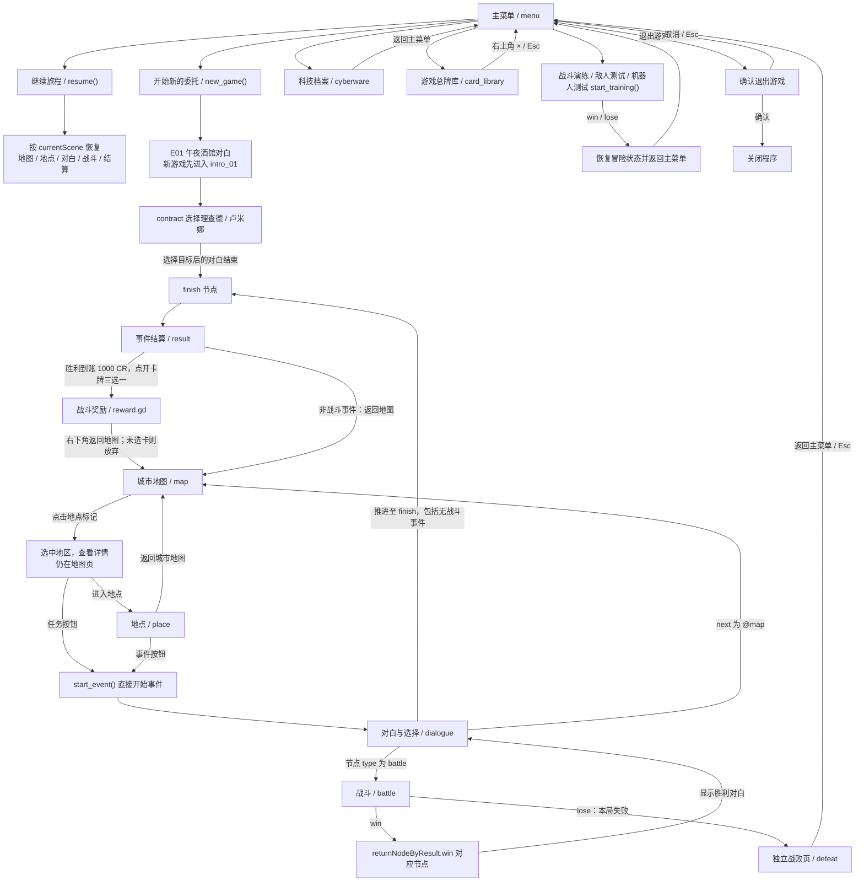

# 午夜委托·第一周 游戏流程与路由

本文说明当前 Demo 的页面如何切换、第一周 5 个事件怎样解锁与分支、战斗结果怎样返回剧情，以及这些行为对应的代码与数据入口。规则本身的含义见 [游戏规则](游戏规则.md)。

**当前说明基线**：**0.4.0-noren-cards**（见 [project.godot](../project.godot)）。**2026-10-22（Asia/Shanghai）**对照当前脚本与配置修正地图资源、战斗阶段及恢复边界等过期说明；本次仅作静态核对，未运行游戏或重跑验收。带日期的接入与测试记录保留其历史范围。

首次文档核对为 2026-10-07、0.2.6-r1；当天的地图、主菜单 P0 和旧逐帧背景属于历史阶段。地图的 `36-capture-final`（5 checks）、`37/38/39`（各 111 checks，0 failures）历史证据见[地图界面验收清单](地图界面验收清单.md)。事件 ID 与内容以 [data/weeks/week1/events.json](../data/weeks/week1/events.json) 和 [data/weeks/week1/week.json](../data/weeks/week1/week.json) 为准。

2026-10-15 剧情更新：主角为自由佣兵；已移除四个阵营专属事件及两场战斗。下列事件和战斗表已同步为当前路由，历史图形验收数字不代表本次实测。

## 页面与切换

页面由 [main.gd](../scripts/main.gd) 的 `VIEWS` 映射和 `Game.page` 共同决定。整个游戏只有一个主场景，切换页面时销毁旧视图并实例化新视图。【已实现】

| 页面键 `page` | 场景 | 主要进入方式 |
| --- | --- | --- |
| `menu` | [scenes/menu.tscn](../scenes/menu.tscn) | 启动、游戏内 `Game.request_menu()` 确认后返回、演练结束或菜单子页返回；演练入口折叠在“演练”分组内 |
| `map` | [scenes/map.tscn](../scenes/map.tscn) | `go_map()`，事件结算后返回 |
| `place` | [scenes/place.tscn](../scenes/place.tscn) | 地图点击“进入地点 →”调用 `visit()` |
| `dialogue` | [scenes/dialogue.tscn](../scenes/dialogue.tscn) | 事件开始或推进到对白节点 |
| `battle` | [scenes/battle.tscn](../scenes/battle.tscn) | 事件节点 `type: battle` |
| `result` | [scenes/result.tscn](../scenes/result.tscn) | 事件 `finish` 节点；正式战斗胜利显示 `reward.gd` 奖励视图，非战斗显示普通结算 |
| `defeat` | [scenes/defeat.tscn](../scenes/defeat.tscn) | 正式战败或恢复失败检查点；只返回主菜单，本局结束 |
| `cyberware` | [scenes/cyberware.tscn](../scenes/cyberware.tscn) | 主菜单"科技档案" |
| `card_library` | [scenes/card_library.tscn](../scenes/card_library.tscn) | 主菜单“牌库”调用 `Game.open_card_library()`，右上角“×”或 Esc 返回主菜单 |

切换细节：

- 2026-10-23：战败页按钮和Esc直接返回主菜单。失败检查点保留，但主菜单禁用继续，菜单Esc不恢复败局。战败页无冒险状态栏、牌库或开发入口，终局禁用F1和加牌控制台。演练保持隔离。

- 2026-10-23：地图“科技配置”调用 `Game.open_technology_loadout()`，由主场景打开携带配置弹层，不改变 `Game.page` 或重建地图。最多携带四项已有科技；每次点击携带／卸下立即写入本次冒险，之后的新战斗生效；面板保持打开以便连续调整，关闭／Esc 保留修改并恢复地图按钮、处理与焦点。与牌库、控制台及退出确认互斥。

- 2026-10-22 顶栏精简：地图移除“周次”按钮；2026-10-23 在“牌库”左侧新增“科技配置”，其右侧仍为“菜单”；日期显示不变。正常地图 Esc 先关闭浮动地点详情，再询问是否返回主菜单。

- 2026-10-22 退出确认：主菜单右下角“退出游戏”先询问，确认后关闭程序；游戏内顶栏“菜单”／“退出演练”先询问，确认后返回主菜单。默认焦点为“取消”，Esc 取消；打开或取消不改变冒险与战斗状态，弹层期间暂停底层输入和处理。正式战斗显示从本场开局继续的提示，演练显示不影响冒险的提示。主菜单总牌库／科技档案的普通返回与演练自然结束不额外询问。

- 2026-10-22：未结束的新正式战斗返回主菜单后，再次继续从本场固定开局恢复；关闭程序后继续同样处理。已结算胜利返回剧情，正式失败进入战败终局。没有 `battleStart` 的旧战斗按原检查点继续；牌库／牌堆弹层关闭不触发重开，演练退出仍恢复冒险。

- 2026-10-16：游戏右上角“牌库”打开当前卡组浏览层，不切换页面键或重建底层视图。×／Esc 返回原画面；浏览期间暂停底层处理并禁用按钮。战斗与演练读取本场完整卡组快照，非战斗页面读取拥有牌；主菜单牌库仍按原页面路由返回菜单。

- 2026-10-15：对白右上角“跳过剧情”沿当前分支跳至最近的选择点；选择点上置灰，玩家选择后可再次跳过。若先遇到战斗、结束或返回地图，则正常进入对应页面。保留剧情结算和奖励，不代选、不跳战斗。
- 只有**进入或离开战斗**时才播放自下而上的霓虹花屏转场（覆盖约 0.58 秒、消退约 0.32 秒），期间锁定输入（`transition_locked`）。其他页面切换直接替换视图。
- 转场或战斗忙碌（`battle_busy`）期间，流程请求会被拒绝，避免重复提交。
- 对白、选项和战斗退出都携带 `revision` 做过期校验；不匹配的请求会被忽略。
- 对白页顶栏“对话记录”打开本次冒险的滚动记录，显示已到达对白与已选选项；关闭按钮或 Esc 返回当前句，回看不会改变剧情位置。记录随冒险保存，旧档只从当前句开始。
- 全局 Esc 优先取消退出确认，再按既有层级关闭当前卡组／控制台／开发面板；对白页随后关闭对话记录，地图页随后关闭浮动详情，再询问是否返回菜单。战斗页先关闭牌堆弹层或取消瞄准，无当前操作时询问是否返回菜单。主菜单按“关闭退出确认 → 关闭场景选择／新委托确认 → 折叠演练分组 → 既有恢复”的顺序处理，存在进度且未消费前述操作时，Esc 恢复当前页面。F1 在开发模式下开关调试面板；输入锁期间不处理这些切换。
- 主菜单的新委托在已有内存进度或磁盘存档时打开内嵌 `Control` 模态弹层：底层按钮禁用并设为 `FOCUS_NONE`，默认焦点在“返回”，Tab 只在两个弹层按钮间循环；取消或 Esc 关闭后恢复原按钮状态，不改动进度或损坏的存档文件。
- 地图页的目标标记通过 `Game.map_target_events()` 推导，不读取 `targetId` 或 `activeEventId`；悬停只提亮并放大图标，不弹出简介框；点击后固定详情，空白处或 Esc 关闭。

下面的流程图概括当前页面路由，覆盖新游戏、地图、事件、战斗与演练的走向：

图中要点：新游戏先进入 E01 对白；地图既能直接开始事件也能进入地点；事件可能没有战斗而直接推进到 `finish`；只有 `finish` 才结算；结算后领取回地图；战斗按 `returnNodeByResult` 返回；演练结束返回菜单且与冒险隔离。

2026-10-23：地图详情和地点页均可调用地点治疗。地下诊所显示“治疗 30% · 150 信用点”，每次扣除 150 信用点并恢复最大生命值的 30%（整数取整并封顶）；医院维持免费。余额不足或生命值已满时按钮禁用并解释原因；流程入口再次校验，拒绝时不改变状态。成功后保留当前页面、地点和日期，地图继续显示原来选中的诊所详情。

2026-10-10 / 0.3.21-library：牌库是占满游戏画布的独立主菜单页面，只修改 `Game.page`，不修改 `state.currentScene`，不加载或创建存档。无冒险进度也能查看；存在进度时浏览后仍可继续原来的地图／对白／战斗／奖励页。总牌库按卡牌定义 ID 去重，包含未获得的卡牌；当前提供 40 种诺伦牌，并可切换已拥有视图。

## 第一周事件与刷新表

2026-10-23 本次调整后，仅保留5个事件，前置全部为无，刷新时间均为随时。事件配置的 `unlockCondition` 统一为 `{}`；地图仍需从候选中刷新，最多同时3项，未刷新项不能绕过入口直接开始。新委托仍先进入E01开场，其他事件不再等待E01、线索或目标条件。

| ID | 标题 | 地点 | 刷新时间 | 必要前置 | 关键推进 | 战斗 | 完成效果 |
| --- | --- | --- | --- | --- | --- | --- | --- |
| E01 | 午夜酒馆 | 地下酒馆 | 随时 | 无 | 选择理查德／卢米娜作为对白目标 | 无 | 记录完成 |
| E02 | 骚动的垃圾场 | 垃圾场 | 随时 | 无 | 战前对白→战斗→胜利对白 | B02 | 记录完成 |
| E03 | 蜂巢城寨的艾克 | 蜂巢城寨 | 随时 | 无 | 支付300或拒绝后战斗；支付选项保留余额条件 | 拒绝路线B03 | 保留后巷线索，已不作为任务前置 |
| E04 | 后巷深处 | 后巷 | 随时 | 无 | 战前对白→战斗→胜利对白 | B04 | 保留港口线索，不再解锁港口事件 |
| E11 | 变异的鱼 | 黑潮泵站 | 随时 | 无 | 战前对白→战斗→胜利对白 | B11 | 记录完成 |

所有首次完成推进1天，第7天封顶；失败、治疗、移动和选择奖励不额外计时。旧档补池不追算日期，保留仍合格项并随机补空位。原文见[现有事件与对话整理](现有事件与对话整理.md)。

E05A、E05B、E08、E12及关联战斗已删除。当前没有配置第一周终局事件。旧档停在退役内容时，非失败进度转地图并锚定E01的finish，已失败旅程保持defeat；已得信用点／卡牌与日期不变，关闭未选的退役奖励，不伪造完成E01。旧阵营E06／E07／E09／E10也遵循同一规则。

### 完成与失败路线

区分"是否完成事件"与"是否返回地图"很重要【已实现】：

- **只有 `finish` 节点才算完成事件。** `enter_node()` 进入 `type: finish` 的节点时，先应用该节点效果，再追加 `completeEvent`，首次追加时同一事务推进1天（第7天封顶），然后把页面切到 `result`。重复完成不重复推进；战斗胜利本身不会完成事件。
- **胜利**从 `returnNodeByResult.win` 回到该事件的 `win_01` 对白，玩家还要继续推进 `win` 系列节点，直到 `finish` 才结算并完成事件。
- **失败**进入独立 `defeat` 页面，显示“战败 / 本次冒险已结束”，只提供“返回主菜单”按钮；Esc同效且不再询问退出。正式战败代表游戏失败，不能回地图重试或继续冒险。
- 失败不完成事件、不发奖、不提供胜利线索、不推进日期。`result: lose` 与战斗历史保存，清空开局快照与待领奖励。致死模型在攻击动画结束前落盘也保存为终局，避免重启撤销败局；开始新的委托正常重置。
- 结算页仍使用 `result` 页面键。2026-10-09 / 0.3.19-rewards 起，`finish` 的 `prepare_battle_reward()` 检查当前事件、战斗、胜利结果与历史，发放一次 1000 信用点并保存三张候选。`result.gd` 对战斗奖励展示 `reward.gd`；普通事件保留原视图。
- 选卡调用 `choose_reward_card(id, revision)`，把 ID 追加到 `state.deck` 并将奖励状态设为 `claimed`，一起保存。右下角退出仍调用 `claim_rewards()`；未选卡则记为 `skipped`，再回地图。模拟演练不会进入此流程。
- 当前没有事件执行`finishWeek`，不会自动标记第一周完成或切换后续周。

## 战斗返回表

每场战斗仍保留 `returnNodeByResult` 配置。当前胜利使用 `win` 映射；正式失败统一进入独立 `defeat` 页面，下表的 `lose` 是保留的旧配置，不再作为实际战败路线。【已实现，2026-10-23】

| 战斗 ID | 所属事件 | 地点 | 参战敌人（`enemyIds`） | `win` | `lose` |
| --- | --- | --- | --- | --- | --- |
| `B02` | E02 | 垃圾场 `junkyard` | `robot` | `win_01` | `lose` |
| `B03` | E03 | 蜂巢城寨 `hive` | `ike` | `win_01` | `lose` |
| `B04` | E04 | 后巷 `alley` | `gang_henchman` → `gang_henchman_second` → `gang` | `win_01` | `lose` |
| `B11` | E11 | 黑潮泵站 `pump` | `fish` | `win_01` | `lose` |

说明：

- 当前8场战斗均胜利返回 `win_01`、正式失败进入 `defeat`。旧 `lose` 对白和映射保留为数据历史；旧失败检查点迁移到战败页。旧 `surrender` 继续兼容旧投降档，不接受新投降结果。
- E01 没有战斗节点，因此不出现在上表。
- `battle_exit()` 校验revision、战斗页面与输入锁；胜利要求返回映射，已致死不能伪报胜利。终局后 `go_map()`、`visit()`、`start_event()`、`enter_node()` 不再推进冒险；重复结果拒绝。

## 演练路由

主菜单的“B04 战斗演练”“敌人测试”与“机器人测试”共用同一条隔离流程，入口收在可折叠的"演练"分组内【临时原型】：

2026-10-19：展开主菜单演练分组后，下方“场景”按钮可为B04选择默认后巷场景或11个已完成背景，包含后巷和地下酒馆。取消/Esc不改变选择，选定后点击B04进入；选择仅为会话内表现偏好，不改变下表中的正式战斗地点、事件或冒险存档。B11仍按自己的地点显示。

1. 展开"演练"分组后点击入口，调用 `start_training(battle_id)`；菜单里分别传入后巷战斗、变异鱼战斗与故障机器人战斗（B04、B11、B02）；机器人测试于2026-10-20新增，使用100 HP和攻击10循环。2026-10-17将原机甲演练入口替换为敌人测试，该机甲事件与B12现已删除，默认演练采用B04。
2. `Game` 先把当前冒险状态完整备份到内存，再标记 `training_mode`，用一个全新临时状态进入该事件的 `battle` 节点。
3. 战斗过程中 `checkpoint()` 与 `commit_combat()` 因为处于演练模式而**不写入冒险存档**。
4. 战斗结束（`win` / `lose`）调用 `finish_training()`：恢复备份的冒险状态，把页面切回 `menu`，并提示"冒险进度和血量未改变"。
5. 演练不发放事件完成标记、信用点或奖励；返回菜单后冒险进度与血量与进入前一致。

新增演练入口时必须确认对应事件存在名为 `battle` 的节点，并引用正确的战斗；否则 `start_training()` 无法进入战斗。

## 代码与数据入口

修改时先定位行为负责的层，再核对它引用的配置和相关测试。

| 内容 | 位置 | 关键点 |
| --- | --- | --- |
| 流程、条件、存档、演练 | [scripts/game.gd](../scripts/game.gd) | `new_game()`、`meets()`、`available_events()`、`start_event()`、`enter_node()`、`advance()`、`choose()`、`battle_exit()`、`claim_rewards()`、`heal_at()`、`start_training()`、`finish_training()`、`initialize_combat()`、`commit_combat()`、`save_game()` / `load_game()` |
| 页面切换与全局输入 | [scripts/main.gd](../scripts/main.gd) | `VIEWS` 映射、`swap_view()`、`play_transition()`、Esc 与 F1 |
| 战斗规则与快照 | [scripts/combat/combat_model.gd](../scripts/combat/combat_model.gd) | `initialize()`、`play_card()`、`end_turn()`、`draw_cards()`、`snapshot()` / `restore()`、`use_item()` |
| 战斗视图 | [scripts/battle.gd](../scripts/battle.gd) | 选牌、出牌、结束回合、调试结果、转场后返回 |
| 牌堆浏览 | [scripts/combat/pile_view.gd](../scripts/combat/pile_view.gd) | 只读五列网格、默认排序、垂直滚动 |
| 地图 | [scripts/map.gd](../scripts/map.gd)、[scripts/map](../scripts/map)、[data/map.json](../data/map.json)、[data/places.json](../data/places.json) | 底图与 17 地点图钉、位置头像、金色目标、浮动详情；目标与状态由 `Game.map_target_events()`／`map_place_state()` 推导 |
| 地点 | [scripts/place.gd](../scripts/place.gd) | 事件列表、治疗、返回地图 |
| 对白与选择 | [scripts/dialogue.gd](../scripts/dialogue.gd) | 逐字显示、选项禁用、空格 / 回车 / 数字键 |
| 事件结算 | [scripts/result.gd](../scripts/result.gd) | 奖励状态、领取或返回、第一周落幕判定 |
| 主菜单 | [scripts/menu.gd](../scripts/menu.gd)、[scripts/menu/menu_environment.gd](../scripts/menu/menu_environment.gd) | 右侧 350px 栏与入口组织；新委托为内嵌 `Control` 模态确认；逐帧动画背景在菜单环境组件中，不写入剧情状态 |
| 科技档案 | [scripts/cyberware.gd](../scripts/cyberware.gd)、[data/cyberware/cyberware.json](../data/cyberware/cyberware.json) | 局外入口，当前无内容 |
| 第一周事件 | [data/weeks/week1/events.json](../data/weeks/week1/events.json)、[data/weeks/week1/week.json](../data/weeks/week1/week.json) | 对白、选项、效果、解锁与事件顺序 |
| 战斗索引 | [data/battles.json](../data/battles.json) | `enemyIds`、`returnNodeByResult`、`placeId` |
| 敌人与角色 | [data/enemies/enemies.json](../data/enemies/enemies.json)、[data/characters.json](../data/characters.json) | 数值、意图序列、立绘资源 ID |
| 资源与配置 | [data/assets.json](../data/assets.json)、[data/config.json](../data/config.json) | 资源路径、开发模式、初始信用点 |
| 临时战斗规则 | [data/prototype/combat.json](../data/prototype/combat.json) | 手牌、牌组、敌人默认值、回合结束处理 |
| 通用 UI | [scripts/ui.gd](../scripts/ui.gd)、[scripts/widgets/neon_button.gd](../scripts/widgets/neon_button.gd) | 字体、按钮状态、立绘与背景 |
| 自动验证 | [tests](../tests) | `run.tscn` 剧情、`combat_tests.tscn` 战斗、`*_visual.tscn` 图形交互 |

## 阅读时的已知边界

以下说明已按 2026-10-22 的当前源码和配置静态核对；本次未修改代码，也未运行这些场景。历史测试不能替代后续改动的验证。

- **地图资源路径的位置**：[map.json](../data/map.json) 的 `cityMapAssetId` 当前为 `city_map_expanded`；[assets.json](../data/assets.json) 的对应项指向 `assets/map/map-expanded-v1.png`，并以 `mapContentRect` 标出原城市区域。旧 `city_map`／`map.jpg` 保留作来源与后备资源。底图与 17 地点标记已经接入；科技教会 `church` 默认开放，可经详情卡进入地点页，再返回地图。
- **地点与可玩内容不同**：17 个地点中，7 个有事件，`tower`、`camp`、`power`、`garden`、`hotel`、`church`、`mall`、`market` 没有事件，`hospital`、`clinic` 只有治疗服务。所有地点默认开放，具体内容见[游戏规则](游戏规则.md)的地点表。
- **战斗标签按模式显示**：`battle.gd` 顶部显示“演练模式 · 不影响冒险”“诺伦 / 形态与弹药”或“旧版测试规则”，已不使用旧“攻击 1 · 敌方 HP 3”标签。敌人生命与意图来自当前战斗模型；[combat.json](../data/prototype/combat.json) 的 3 HP／攻击 1 只是缺少对应定义时的原型回退值，不能代表所有敌人。
- **`lose` 是占位**：该节点的文本写明"后续剧情待补"；它不设置任何旗标，只把结果记入 `battleHistory`。
- **首次发牌与旧快照**：`start_hand()` 依据模型的 `opening_draw_done` 判断首次发牌；新快照保存 `openingDrawDone`，已完成开场抽牌后即使手牌为空也不会重发。仅缺少该字段的旧快照在 `restore()` 中使用“第 1 回合、手牌为空且弃牌为空”推断，不能把此兼容逻辑写成当前新快照的判断规则。
- **多敌与手牌扩展范围**：当前 B11 为双鱼、B04 为三人黑帮战，诺伦补牌目标为 5 张、基础牌组为 10 张；已不是单敌三张手牌原型。相关历史专项见[维护文档](维护文档.md)，本次未重跑。增加敌人数、扩展牌组或手牌上限时仍需检查布局、输入、规则和存档，不能外推历史样本的覆盖范围。
- **存档兼容不只版本 1 → 2**：`migrate_save()` 还补齐 schema 2 缺少的主角、奖励、对话记录和科技字段，并调用 `migrate_mercenary_story()` 处理已移除的阵营剧情；战斗恢复另处理可选字段缺省。没有通用降级迁移。新增字段、删除 ID 或回退程序前，按[维护文档](维护文档.md)的存档章节核对具体路径。
- **对白立绘无条件去白**：透明对白 PNG 不能只靠 `whiteKey=false` 关闭去白；详见 [维护文档](维护文档.md)。
- **地图坐标以原城市区域为基准**：`coordinatesStatus` 为 `illustration-calibrated`，17 个 `mapAnchor` 相对于 `mapContentRect` 对应的原城市区域，`map_rect` 与 `_art_rect` 分别表示原城市和完整扩绘图。更换底图时先核对区域映射；保留原城市构图的扩绘可沿用锚点，内部布局改变时需重校。
- **本次只做文档静态核对**：2026-10-22 未运行游戏、未修改代码或用户存档，也未重跑剧情、战斗和地图验收。[地图界面验收清单](地图界面验收清单.md)中的 `36-capture-final`（5 checks）与 `37/38/39`（各 111 checks，0 failures）为2026-10-07的历史结果，不是本次实测。

## 相关文档

继续查阅玩法含义、维护边界或资源方向时，使用以下入口。

- [游戏规则](游戏规则.md)：玩法循环、战斗数值、治疗与日期、奖励与存档的规则说明。
- [文档索引](README.md)：各份文档的用途与阅读顺序。
- [维护文档](维护文档.md)：修改约定、存档恢复、已知边界与回归命令。
- [修改记录](修改记录.md)：各次修改的原因与验证记录。
- [开发接入说明](开发接入说明.md)：卡牌、敌人、资源与剧情的接入方式。
- [美术方向](美术方向.md)：城市总览地图与标记的美术方向。
- [项目说明](../README.md)：体验方式与版本概览。

## 2026-10-19 B04正式敌人接入

以下保留2026-10-19的战斗接入记录；当前E04前置已置为无，原对白、胜败返回和港口线索保持原路由；战斗阵容为两名小弟各15 HP、老大30 HP，小弟依次行动后老大行动。老大左侧两小弟、最右老大呈三角形。当前老大仅在完整回合结束、全部敌方行动完成后的下一玩家回合边界检查小弟死亡并切换攻击循环；玩家阶段击杀小弟后，当轮老大仍执行已显示的强化，下一玩家回合才显示攻击8。规则见[游戏规则](游戏规则.md#后巷深处力量与易伤2026-10-19)。主菜单B04演练同样保留15／15／30 HP，独立三人动作测试显式使用各100 HP并不继承正式阵型。旧快照不追补新阵容。
